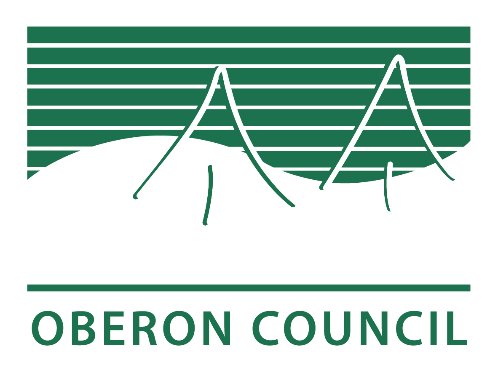
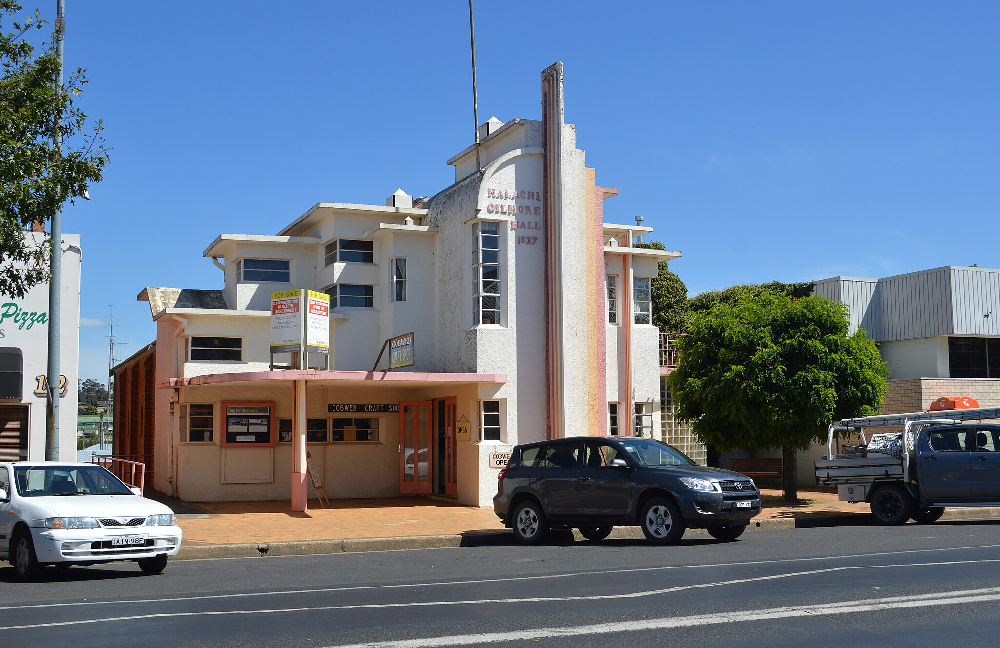
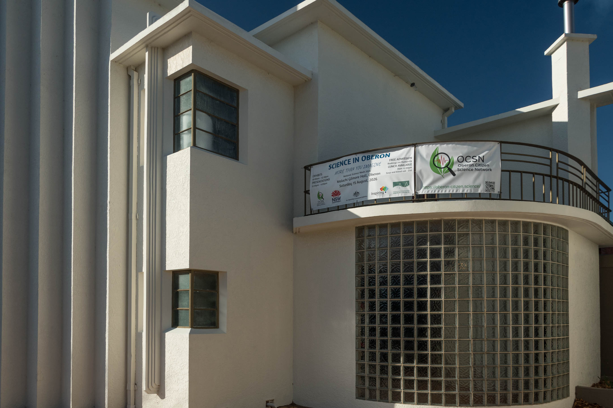

To mark National Science Week 2026, Oberon Citizen Science Network presented a free community event, **"Science in Oberon: More than you imagine"**, at the [Malachi Gilmore Hall](https://malachigilmorehall.com.au) in Oberon on Saturday, 15th August 2026.

::: {.callout-note}
An archived copy of the page used to advertise the 2026 National Science Week event **Science in Oberon: More than you imagine!** is available [here](national-science-week-2026-oberon-archived.html). The links in it may no longer be valid.
:::

::: {.callout-note title="Funding acknowledgements"}
This [Inspiring Australia NSW](https://inspiringnsw.org.au) initiative is supported by the Australian Government as part of [National Science Week](https://www.scienceweek.net.au). Oberon Citizen Science Network also gratefully acknowledges support for this event by [Oberon Council](https://www.oberon.nsw.gov.au/Home) through its Section 356 community funding scheme.

::: {layout="[[80, 20]]"}

{fig-align="center"}

{fig-align="center" width=150}
:::

:::

::: {.aside}
The National Science Week 2026 event in Oberon was held on Saturday 15th August 2026 in the wonderful _art deco_ [Malachi Gilmore Hall](https://malachigilmorehall.com.au) in co-operation with its owners, Lucy and Johnny East. The Malachi Gilmore Hall is an architectural gem that looks like it has just landed from Outer Space, despite being built in 1937.

:::

Overall, the event was a great success, with over 90 people attending the morning session of science and technology-related exhibits, and over 60 people attending the afternoon program of talks given by local and visiting speakers.

All aspects of the day were recorded in a series of videos, available via [this YouTube playlist](https://www.youtube.com/playlist?list=PLV47W5g3k9QA) or at the individual links below.

## 15th August 2026 event at the Malachi Gilmore Hall, Oberon

---

## Videos

### Pre-event field trip on 14 August 2026 to observe Southern greater gliders in Gurnang State Forest, about 30kms south or Oberon township, led by Dr Ana Gracanin, ANU Fenner School of Society and Environment

Elevation about 1260 metre above sea level, air temperature 1 degree C, still conditions (it was snowing at this location just 4 days earlier).

---

#### Short version - 8 minutes



---

#### Long version - 54 minutes



---

### Events at the Malachi Gilmore Hall, Oberon on 15 August, 2026

#### Overview video of set-up, morning exhibitions of science-related project and demonstrations, and afternoon talks by local and guest speakers - 16 minutes

Including welcome to event by Clr Andrew McKibbin, Mayor of Oberon, and Acknowledgement of Country by Aunty Ruby Dykes, Trickett's Arch Biodiversity Site Aboriginal Corporation.



---

#### Detailed explanations of the exhibits of science-related projects, demonstrations and posters, 10:00 am to 12:30 pm - 26 minutes



---

### An afternoon of science and technology talks by local and invited speakers

#### Introduction to OCSN and its activities, goals and plans, Tim Churches, OCSN Co-founder & President - 19 minutes



---

#### Greater gliders and other arboreal marsupials: ecology and conservation, Dr Ana Gracanin, Australian National University Fenner School of Environment & Society - 37 minutes



---

#### Effects of climate change on platypus populations in the Fish and Duckmaloi Rivers near Oberon, Jackson Wilkes Wilburn, School of Biological, Environmental and Earth Sciences (BEES), University of NSW - 22 minutes



---

#### The effects of wind farms on Australian bird species -- what we know and what we don't know, Malan Bothma, School of Biological, Environmental and Earth Sciences (BEES), University of UNSW - 25 minutes



---

#### Eco-acoustics for biodiversity assessment, Alan Sheehan, OCSN	Co-founder & Public Officer - 18 minutes



---

#### Biodiversity at Jenolan Karst Conservation Reserve, with a special look at platypus research, Dr Anne Musser, Jenolan Caves Trust and NPWS - 26 minutes



---

