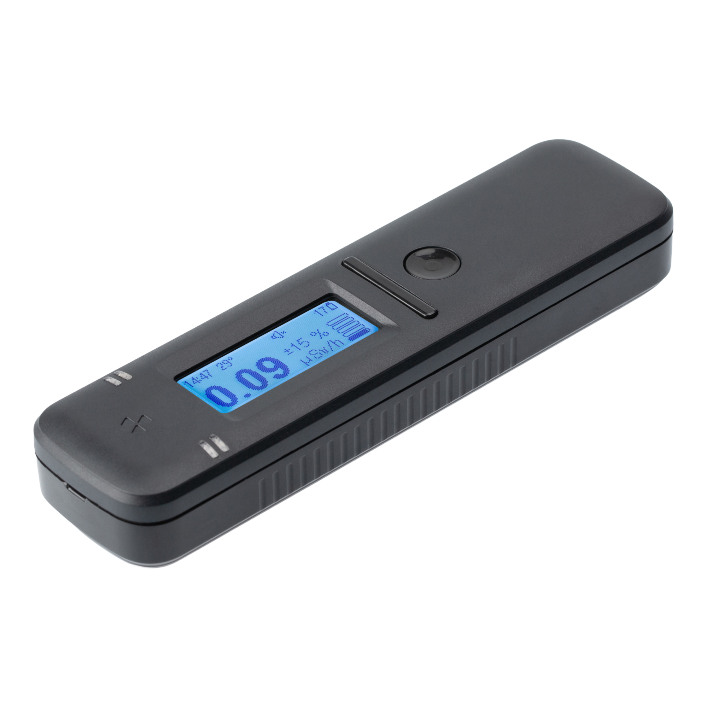
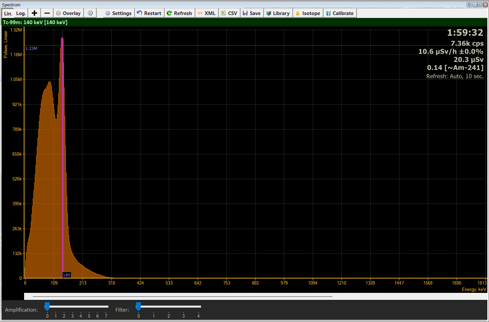
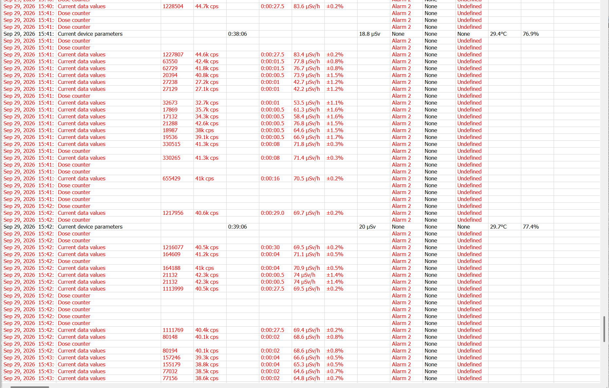
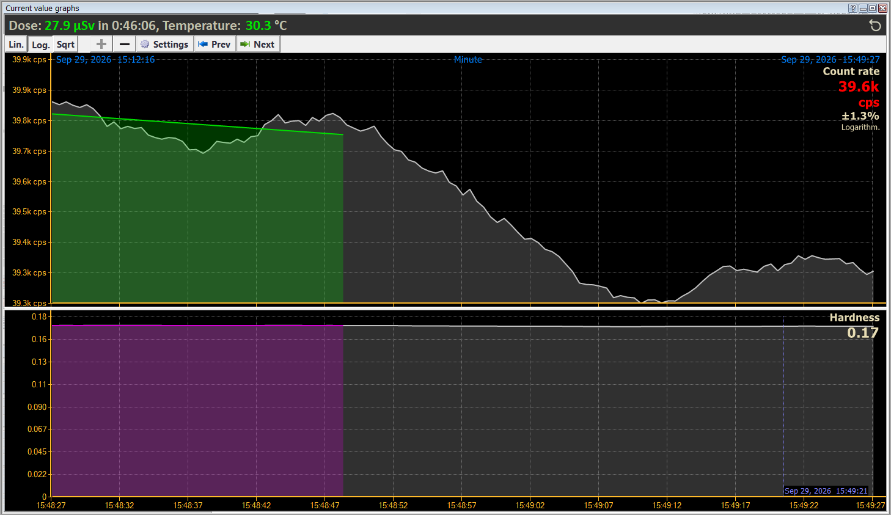
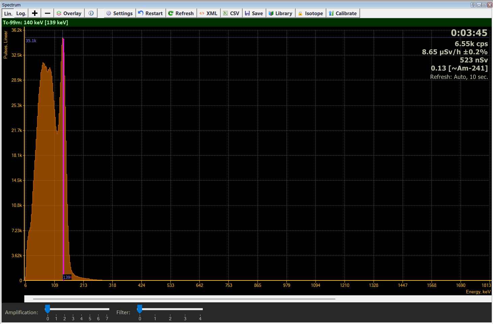
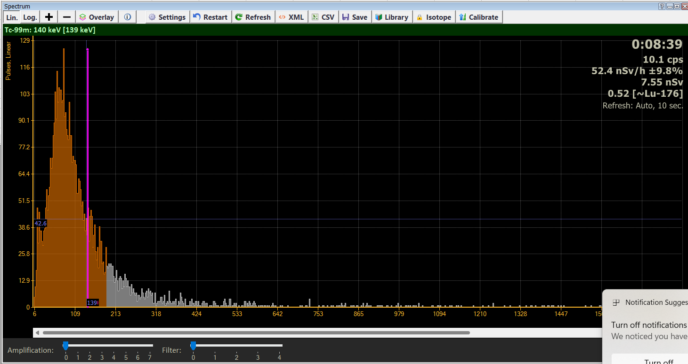
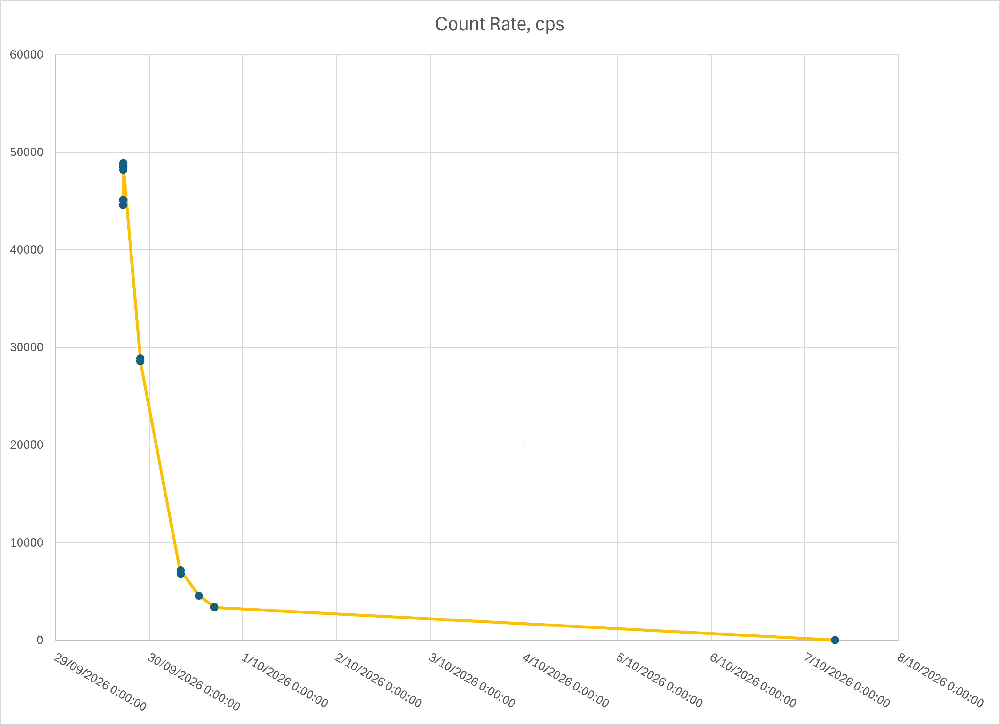
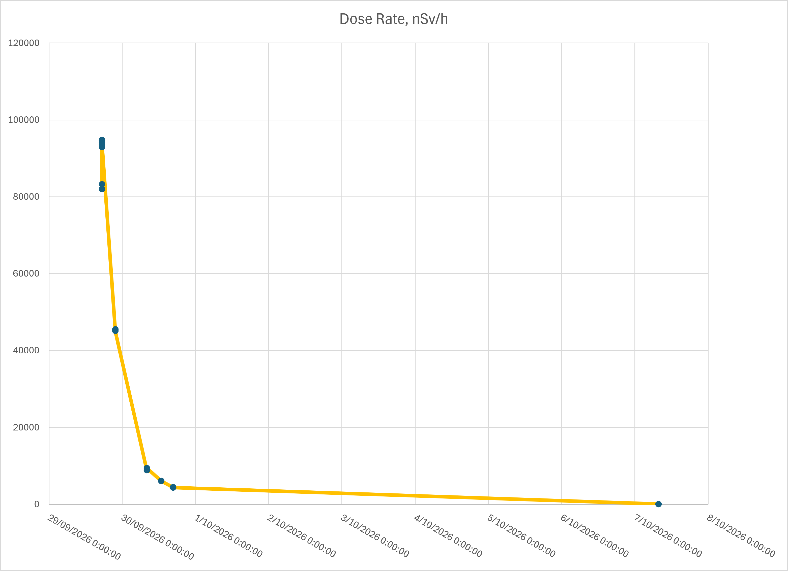

::: {.aside}

:::

As background, during my career as a professional mechanical engineer I have had some experience with industrial radiation gauges and sources, and so an interest in nuclear science that started during my teens has been trickle fed over time. A couple  of years ago, I purchased a [Radiacode 110 radiation detector](https://radiacode.com/products/radiacode-110?lang=en), motivated largely out of curiosity and my persisting interest in nuclear science. So, a procedure involving nuclear medicine can’t be ignored! It was an ideal opportunity to play with the Radiacode…

The procedure (a bone scan) involved having first a normal x-ray CT scan of the spine and then receiving an injection of the nuclear medicine agent – based on the medical isotope [Technetium (Tc) 99m](https://en.wikipedia.org/wiki/Technetium-99m) (see also [here](https://radiacode.com/isotope/tc-99m?lang=en)). A couple of hours later, a second scan was taken with the Tc 99m accumulating in areas of high inflammation (arthritis) – highlighting the areas of inflammation in or around the spine in which the Tc 99m agent preferentially accumulates. Radiation in the form of gamma ray photons, emitted by the Tc 99m, is then detected via computerised single-photon tomography, which is similar to a normal CT scan but it detects gamma ray photons emitted from the patient rather than x-rays shone through the patient. The scan is then compared to the first CT scan to highlight areas requiring treatment, such as a steroid injection to reduce local inflammation..

The Tc 99m was administered at approximately 11:00am accompanied by the advice “don’t hold any babies for 24 hours”. This was not advice I expected or I’ve received before, but in hindsight perfectly practical. Tc 99m has a half-life of 6.01 hours, so after 6 hours the radiation it emits is halved, after 12 hours it is quartered, 18 hours divided by 8, and after 24 hours the emited radiation level should be reduced to 1/16th of the initial levels. The realization that radiation levels were high enough to be a potential risk to babies was unexpected (to me) though. So, we live and learn.

Once home, I got the Radiacode device out to see what’s going on. 

Immediately when I turned it on, it's internal alarm was going off… was it a fault?… er… no, it was just me!

Initially I tried scanning different body parts to see if the Tc 99m was accumulating in places that were detectable by the Radiacode, but it appeared body mass was the most important factor in the distribution of radiation, so I settled on placing the Radiacode against the bottom of my sternum as the most repeatable location to take readings. So in the recording log files the highest measurements were taken at the base of the sternum, and other measurements are either other body parts or just sitting on the desk nearby.

Figure 1 (above) shows the spectrum of the radiation I was emitting at nominally 4 hours and 45 minutes after administration of the dose. The spectrum is built over time by the Radiacode by measuring the frequency (energy) of the gamma ray (in this case) radiation.

Moving the cursor allows the identification of isotopes causing the various peaks in the spectrum. The peak at 140keV is clear and dominant and characteristic of Tc 99m.

The explanatory data in the top right-hand corner, at this time the decay rate is 7360 cps (counts per second), and the radiation level is 10.6 µSv/h (but not necessarily sampling at the bottom of the sternum). The dose (20.3 µSv) is not necessarily accurate since it wasn’t zeroed prior to starting measurements, but the difference between this and subsequent dose measurements will be valid. The final figure in the top right-hand corner of the spectrum is the “radiation hardness” (0.14) which is a quick indicator of how energetic the radiation is. Low energy radiation is of course relatively safe, but high energy radiation can be much more damaging for the same decay rate, so a quick assessment of hardness gives the operator a guide as to whether it is safe to stay and take a reading, or whether it’s more important to get away quick!

Figure 2, above, shows part of the Radicode log file. The red text indicates the Radiacode is in an [alarm condition](https://radiacode.com/docs/en/100-series/alarms/how-alarms-work) (Alarm level 2) due to high radiation level. The Radiacode uses a similar data handling method to commercial GPSs in that it combines or accumulates data for as long as it is consistent before saving a data point rather than saving data on a fixed frequency, hence some data points may be collected over quite a long time (e.g. 27s or more).

Figure 3, above, shows the count rate and hardness plots from the Radiacode software.

Figure 4, above, shows the spectrum collected at about 20 hours after administration of the Tc 99m dose, and the Tc99m peak is still clear and dominant.

Figure 5, above, shows the spectrum collected 8 days and 20 hours after dose administration, and by this time there is no detectible trace of the Tc 99m. The spectrum is reflective of a normal background reading.

Figure 6, above, is a plot of the peak Count Rate (corresponding to measurement at the base of the sternum). There is an anomaly in the data at the top of the curve probably resulting from inconsistency in sampling technique, however the general shape of the curve reflects the exponential decay of the Tc 99m isotope, and the steepness of the curve reflects the short half life (6.01 hours).

Figure 7, above, is a plot of the Dose Rate. It reflects the shape of the Count Rate curve (Figure 6) including the data anomaly. The difference in shape between the Count Rate and Dose Rate curves depends entirely on changes with radiation hardness (energy) including background radiation.

Just to give a comparison of radiation hardness (energy), Technetium 99m gamma ray energy is 0.140 MeV, Cesium 137 (as commonly used in radiation gauges in the local factories)  gamma ray energy is 1.176 MeV, and Cobalt 60 (as used in the MDF furnace radiation gauge) decay energy is 2.822 MeV in two gamma rays and a beta particle.

