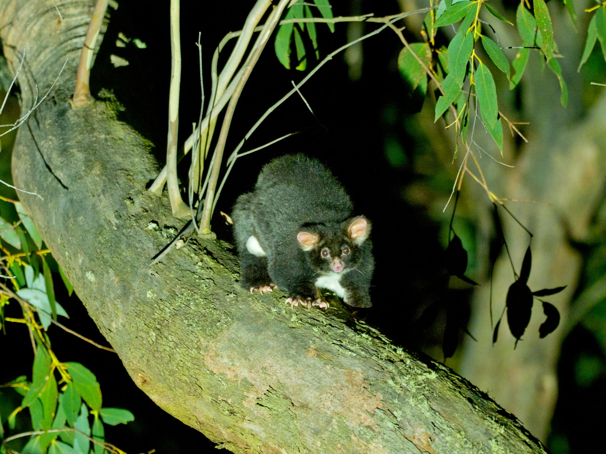
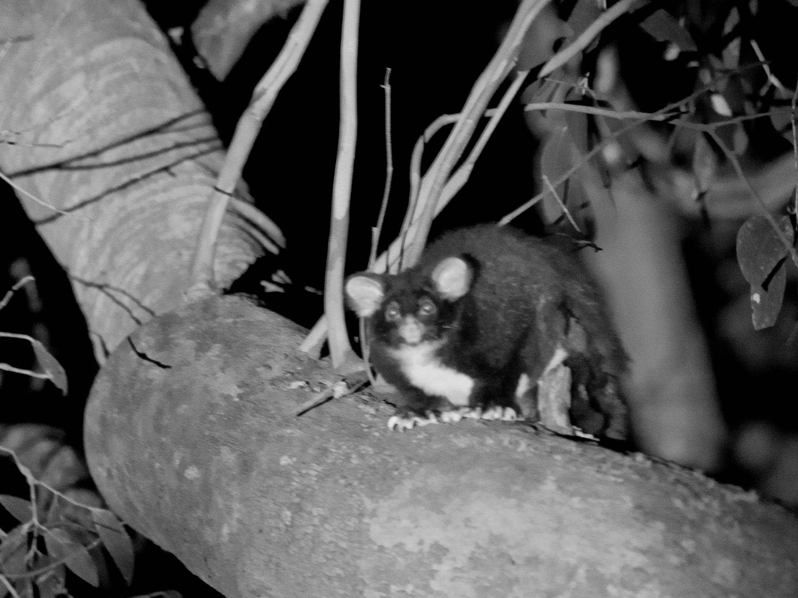
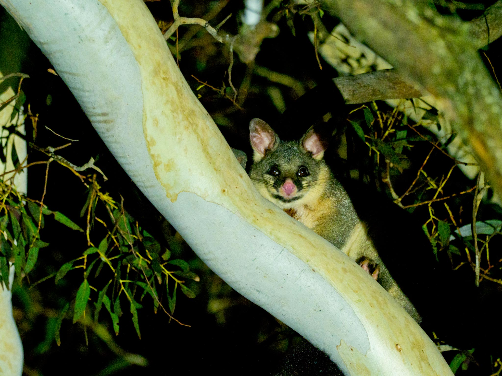
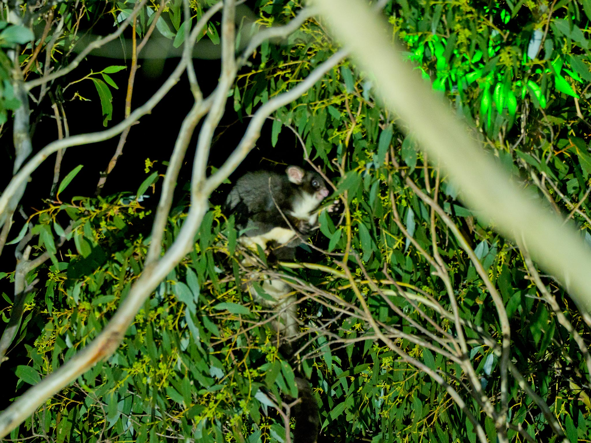
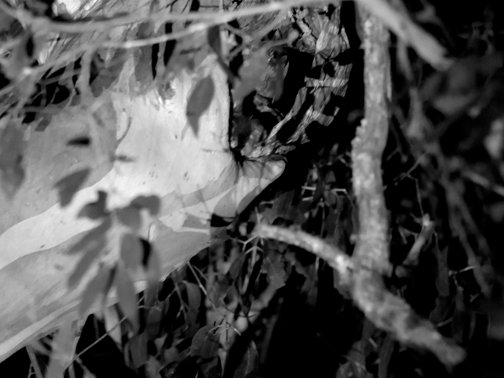
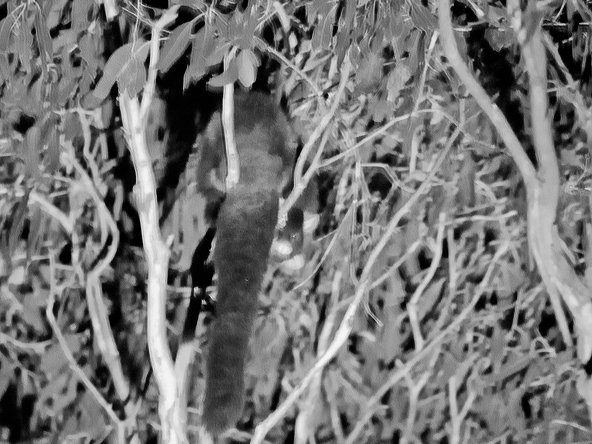
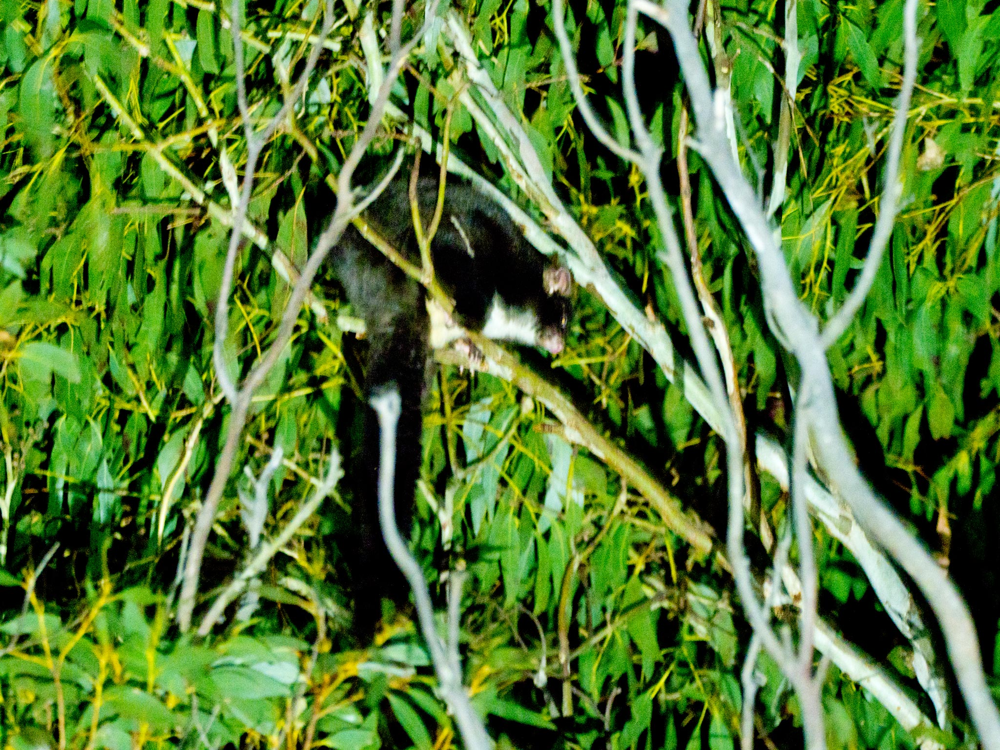
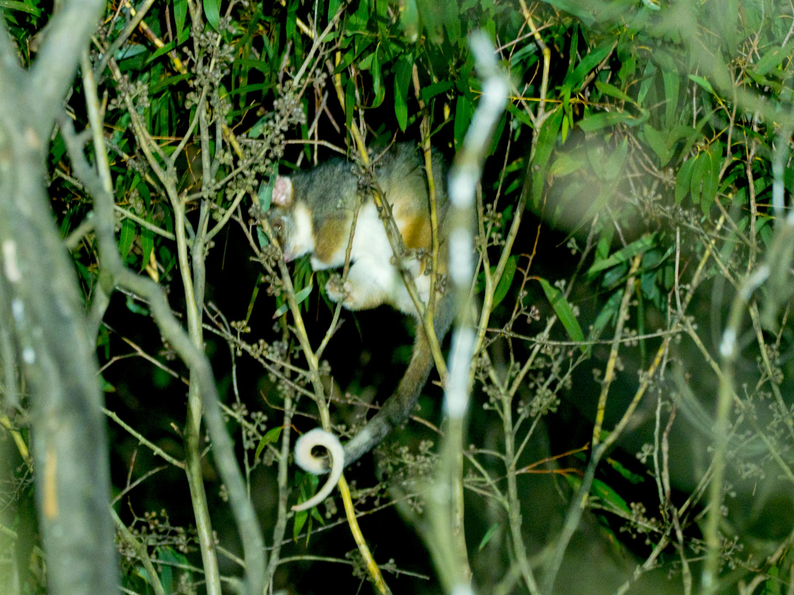
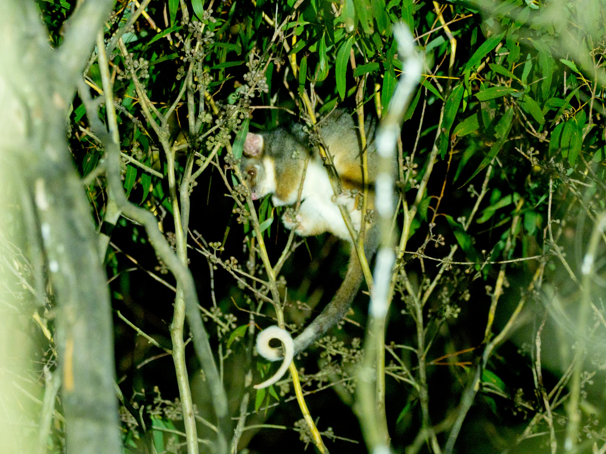

Oberon Citizen Science Network (OCSN) is proud to announce that the presence of southern greater gliders (_Petauroides volans_) has been confirmed in Gurnang State Forest. [Southern greater gliders](https://en.wikipedia.org/wiki/Southern_greater_glider) are listed as endangered by the New South Wales Biodiversity Conservation Act, the ACT Nature Conservation Act, the Commonwealth EPBC Act, and the [IUCN Red List](https://www.iucnredlist.org/species/40579/217036853). They are listed as vulnerable in Victoria and Queensland, the two other States in which they occur. As such, it is very satisfying to find them locally, in a location in which they were previous unknown and quite unexpected.

OCSN has been developing novel thermal video cameras for nocturnal wildlife detection for some months now. Initially developed for detecting platypus (and rakali) in headwater streams, the technology is being adapted for use in the search for arboreal (tree dwelling) species. While using these thermal cameras to try to confirm the presence of [spotted-tail quoll](https://threatenedspecies.bionet.nsw.gov.au/profile?id=10207) in Gurnang State Forest, which we strongly suspect are present from eco-acoustic data we have recorded, we happened to capture what appeared to be a greater gliders falling to the ground, which they rarely do. After pointing the thermal video cameras up at some likely nearby den hollows, we were able to confirm the presence of Southern greater gliders. A video documenting this discovery is available [here](https://www.youtube.com/watch?v=D2J44hklYTM).

On the basis our discovery, OCSN invited Dr Ana Gracanin, a noted greater glider researcher at the Australian National University Fenner School of Environment & Society, to be a keynote speaker at the [_Science in Oberon - More than you imagine_](https://oberon-citizen.science/national-science-week-2026-oberon.html) event on 15 August at the Malachi Gilmore Hall, which OCSN organised as part of National Science Week 2026. Ana kindly offered to lead a small party of OCSN members on a spotlighting field trip on the evening before the event, in the area in which we had previously discovered greater gliders, to allow us to undertake some direct observation and to obtain full colour photographs of them, as opposed to the monochrome thermal video we had obtained to date.

The location of the greater gliders is in a block of native timber about 60 hectares in size, made up of Central Tableland Montane Wet Forest and Central Tableland Peppermint Shrub-Grass Forest, and completely surrounded by pine plantation forest except for a thin corridor along a creek which flows through the area (in which we suspect there may be platypus - we plan to investigate that soon). Evidence suggests the block has been selectively logged in its past but still contains many huge old growth trees with abundant hollows at least 10m above ground, which are so necessary for greater glider survival.

During a short one hour walk in this area, covering no more than 500m, five different southern greater gliders were observed and photographed, as well as a common brushtail possum (_Trichosurus vulpecula_) and a common ringtail possum (_Pseudocheirus peregrinus_). The density of greater gliders is very encouraging and suggests that the population is viable despite being in a native forest island inside the surrounding pine plantation. Videos documenting this field trip are available in both [short](https://www.youtube.com/watch?v=RRcL3gh7asY) and [long](https://www.youtube.com/watch?v=v_ZZM_Go6XI) forms. A video of Ana's very informative talk at the _Science in Oberon_ event is also available [here](https://www.youtube.com/watch?v=elw4NOclWlg).

OCSN is undertaking further work to see if southern greater gliders can be found in nearby neighbouring native timber blocks in Gurnang State Forest. Dr Gracanin reported that there was evidence that greater gliders are able to travel through pine forest, the longest known distance being seven kilometres for one individual.

---

::: {.callout-tip}
You can click or tap on any of the images below to see a full-screen version of it.
:::

---

---

---

---

---

---

---

---

---

## Camera and image processing information

* Olympus OM-D E-M1 Mark II camera
* Olympus M-Zuiko Digital 300mm f1.4 Pro lens
* Olympus M-Zuiko Digital 1.4x Teleconverter (combined focal length = 420mm. Equivalent full frame focal length = 840mm)
* Both In-camera and In-lens image stabilisation in use.
* Images were shot at ISO 3200 in both Raw and JPG.
* Post processing of Raw files included:
* Exposure adjustment/correction
* Over-exposure recovery where required
* Fill light adjustment
* 10% increase in clarity, vibrance and saturation
* Motion blur correction where required
* Focus correction where required
* Black and White conversion layer for images shot under red light illumination
* Images shot under white light illumination are in colour.
* Images shot under red light illumination are in black and white.
* The extreme conditions of low light and long focal length challenged and often beat the image stabilisation, so many shots were discarded and some of those kept are not high quality, but are adequate for species identification.
