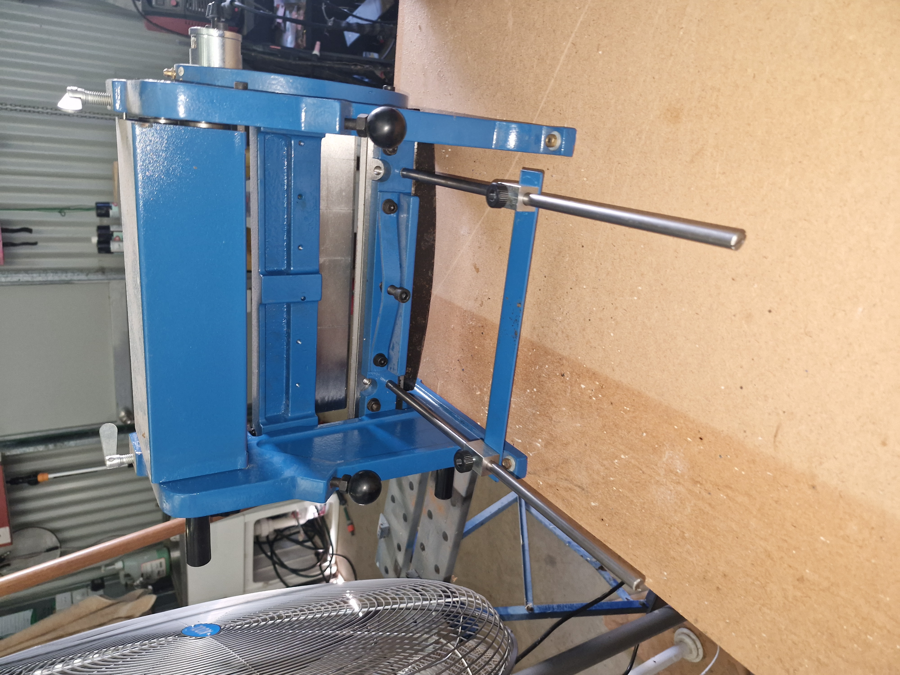
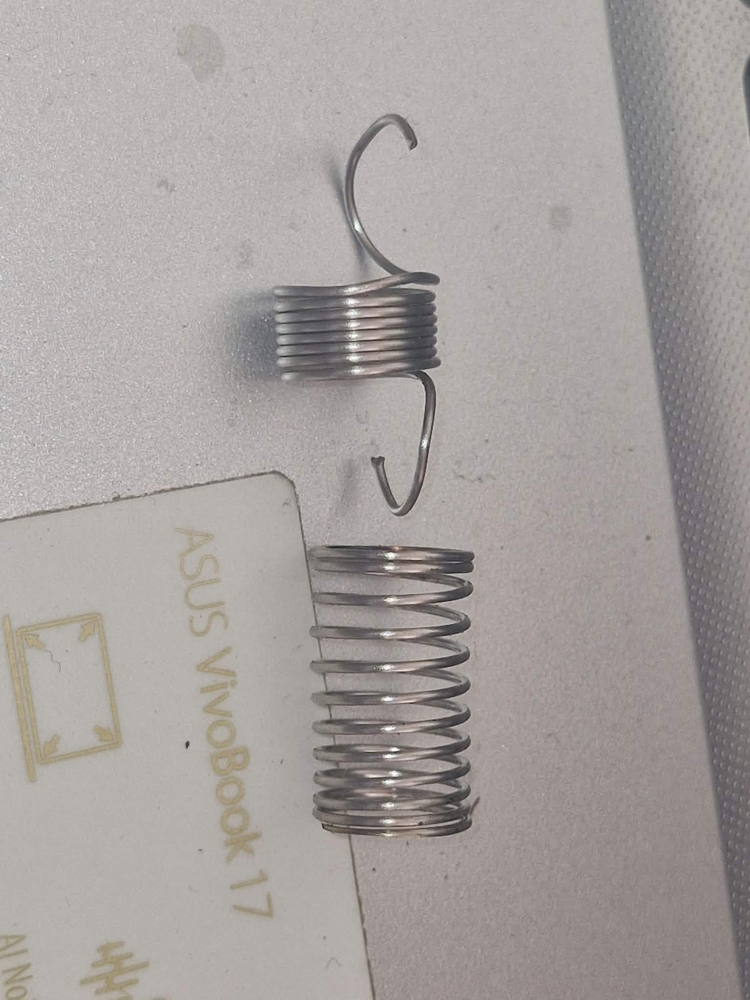

Richard Harrowell was a founding member and past committee member of Oberon Citizen Science Network (OCSN). He died suddenly in 2026, and is sorely missed by his many friends, including many members of OCSN. Following his death, his family approached OCSN to see if we were interested in any of Richard’s extensive collection of electronic, electrical and scientific equipment. They didn’t want any money, they just wanted to see the gear go to good homes where it would be used. The equipment was donated to OCSN to use or to sell to raise money for projects.

While assisting Richard's family to sort through his electronic, electrical and scientific equipment, I spotted this little 3-in-1 machine -- it's a combination sheetmetal roller, folder and guillotine.

As I hate to see good machines and tools go to scrap or waste I offered to buy it if no-one in the family wanted it.

In the end no-one in the family wanted it, and like all Richard's gear, the family didn't want any money for it - they just want to see it go to a good home where it'll be used - so they gave it to me.

As I got it, it wasn't complete. It was missing the rear fence (used to consistently cut the same length of metal sheet) and also the pressure bar to hold the sheet metal down while cutting. These parts were probably not identified as part of the machine by the family and lost among other stuff.

::: {.aside}

A bright bar is a type of precision steel or metal bar stock that has undergone cold-finishing processes—such as cold drawing, turning, peeling, or grinding—to achieve a smooth, bright, and scale-free surface.

:::

After enquiring about the spare parts price for the missing bits, which turned out to be more than the cost to buy a complete new machine, I set about making the parts to restore it to full functionality.

Like all projects, that’s easier said than done. I had the fence rail for the back of the guillotine, but no mounting bars or clamps. I had some ¾” square key steel left over from a previous project, and a selection of bolts and screws in “consolidated revenue”. So I needed to buy 10mm round bright bar for the fence bars, and some square or rectangular bright bar for the pressure bar – neither was as easy to get as I expected it to be.

::: {.aside}

:::

After trying multiple engineering and steel suppliers, I eventually got some 10mm round bright bar from Certoma Engineering, but the rectangular bar for the pressure bar was more difficult. For some reason I haven’t been able to ascertain, small rectangular and square bright bar sections were scarce even from dedicated steel suppliers.

A mate of mine in the Hunter Valley has a larger sheet metal guillotine and he had just finished building a new pressure bar for his machine and offered to give me some that was left over. It was a bigger section than I was looking for, but the price was right! It would require some machining to make enough room for the hold down springs to work. Two notches were cut in the pressure bar with a 20mm end mill to make the bar fit.

The other things that were a potential problem to source were the springs. I had some specific requirements in terms of space and spring travel, so resolved to make my own springs. To do so, I made some simple [mandrels](https://en.wikipedia.org/wiki/Mandrel) to wind the springs around on my lathe using the automatic feedscrew to provide a controlled pitch for each revolution turned by hand (so I could count the turns). I spent some time practicing this skill to make both compression and tension springs before making the real ones for this project.

::: {.aside}

:::

I ended up with a spring pack made of 3 springs for each side, nested inside each other and coiled the opposite way alternately so they can’t get tangled. Designing springs can be a bit of challenge in itself when space is limited. In this case, the fully compressed length was a limiting factor which meant the number of turns was inversely proportional to the wire diameter, hence the design choice of the 3 spring pack of smaller diameter wire springs rather than a single spring from larger diameter wire on each side.

Part of the equipment donated to OCSN from Richard’s estate was a 3D printer. This provided the means for the final touch on the guillotine fence clamps. Two ABS knobs were 3D printed to suit a couple of M5 bolts and turn them into thumb screws for the clamps, so no tools are necessary to adjust the guillotine fence.

And so Richard’s roller, folder and guillotine is back to full functionality and arguably better than new, with a larger fence adjustment range than standard. Time will tell if the springs are adequate for the job or not, but if they aren’t we have the means to make new ones that should do the job.

We plan to use the device for several forthcoming OCSN projects, which will be the subjects of future blog posts!

::: {.callout-note title="Figure3: Video of the guillotine pressure bar mechanism working"}



:::

